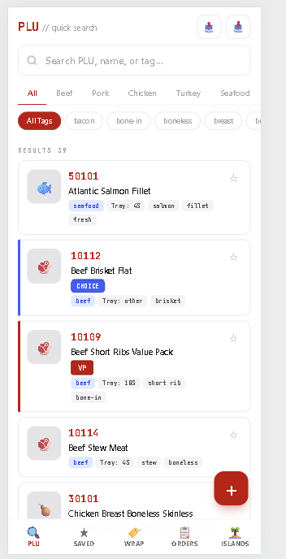

# PLU Quick Search

A phone-first PLU lookup, special-order tracker, and case-layout planner for the meat counter.

[](https://plu-app-3.vercel.app)
[](https://nextjs.org)
[](https://www.typescriptlang.org)
[](https://tailwindcss.com)
[](https://vitest.dev)

**Live demo: <https://plu-app-3.vercel.app>**



## About

I work behind a grocery store meat counter, where staff constantly look up PLU codes, tray sizes, and weights, and track customer special orders on paper. I built PLU Quick Search on my own time to solve that problem for myself: one phone-friendly app built for speed with one hand.

The app has no backend and no account. Everything is stored in the browser's `localStorage`, so it loads fast and keeps working without a connection.

## Features

- **PLU search and filters**: fuzzy, scored search over PLU number and product name, plus category tabs (beef, pork, chicken, turkey, seafood, lamb, other) and tag filters. Related products are grouped into expandable cards.
- **Special grade tags**: tags like Wagyu, Grass Fed, Prime, Choice, Select, Value, VP, TX, Thick, and Thin render as distinct color-coded badges.
- **Saved favorites**: star any PLU and find it on the Saved tab.
- **Wrap mode**: a category-driven view for fast tray and weight lookups, with a paged grid of recents sorted by how often each item is used.
- **Customer orders**: create orders with a name, phone, pickup date and time, line items (PLU, quantity, weight, notes), and a status (Pending, Ready, Picked Up, Cancelled). Overdue and due-today orders are flagged, and any order can be copied to the clipboard as formatted text.
- **Case and island layout editor**: plan a weekly layout for three cases with left/right slots, endcaps, and extra sections. Slots can carry deal flags (Coupon, BOGO, Free Item, Manager's Special, New), and the plan exports to a **PDF planogram** via jsPDF.
- **PLU management**: add, edit, and delete entries (with optional photos), and import or export your list as JSON. A default list of PLUs is bundled.
- **PWA install and offline support**: a web app manifest and a service worker (network-first, with cached fallback) let you install the app and open it without a connection.
- **Test suite**: Vitest and Testing Library cover search and fuzzy matching, grouping, order formatting and date logic, island planning, and the debounce hook.

## Tech Stack

| Area | Choice |
| --- | --- |
| Framework | Next.js 16 (App Router) |
| UI | React 19 |
| Language | TypeScript 5 |
| Styling | Tailwind CSS v4 |
| PDF export | jsPDF |
| Storage | Browser `localStorage` |
| Offline | Service worker + web app manifest |
| Testing | Vitest, Testing Library, jsdom |
| Linting | ESLint 9 |
| Hosting | Vercel |

## Project Structure

```
plu-app_3/
├── docs/                 # README assets (screenshot.png)
├── public/               # manifest.json, sw.js, app icons
└── src/
    ├── app/              # layout, page, global styles
    ├── components/       # tabs, cards, forms, sheets, island map
    ├── data/             # defaultPLUs.json
    ├── hooks/            # useDebounce
    ├── lib/              # stores, search, grouping, special tags, PDF export
    ├── test/             # Vitest setup
    └── types/            # PLU, order, and island types and helpers
```

## Running Locally

Requires Node.js 20 or newer.

```bash
git clone https://github.com/Sa1vad0r/plu-app_3.git
cd plu-app_3
npm install
npm run dev
```

Open <http://localhost:3000>.

Other scripts:

```bash
npm run build   # production build
npm start       # serve the production build
npm run lint    # ESLint
```

## Running Tests

```bash
npm test                # run the suite once
npm run test:watch      # watch mode
npm run test:coverage   # with coverage
```

## Install on Your Phone

Open <https://plu-app-3.vercel.app> on your phone, then:

- **iPhone (Safari):** tap the Share button, then **Add to Home Screen**.
- **Android (Chrome):** tap the **⋮** menu, then **Add to Home Screen** or **Install app**.

It then launches full-screen like a native app and works offline.

## Author

**Salvador Alfaro Jr.**

- GitHub: [@Sa1vad0r](https://github.com/Sa1vad0r)
- LinkedIn: [salvador-alfaro-jr](https://www.linkedin.com/in/salvador-alfaro-jr)
